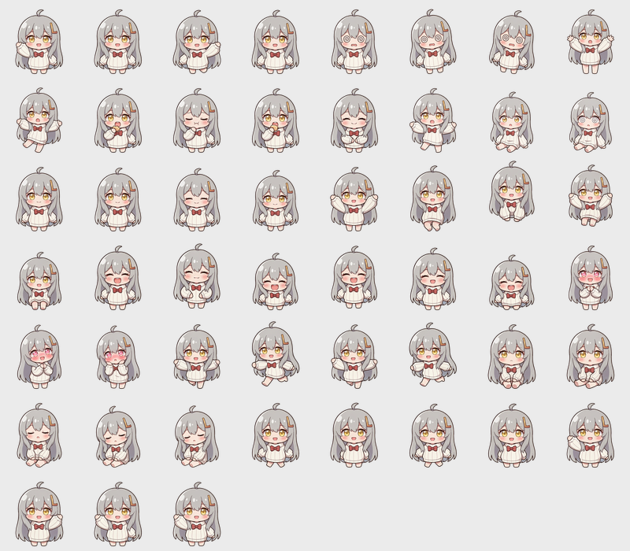

# MacPet · 桌宠小姑娘

一只住在桌面上的二次元小姑娘：银发呆毛、金色大眼、白色条纹宽袖毛衣、红蝴蝶结。透明无边框窗口，悬浮在其他窗口之上，会在桌面底部自己溜达；可以拖着走、摸头、喂东西，饿了会叫，困了会自己睡，闲着自己挥手、跳舞、捧腹大笑。

**支持 macOS（Apple Silicon / Intel）和 Windows 10 / 11（x64），功能完全一致。**



## 环境要求

- macOS（Apple Silicon 或 Intel）或 Windows 10 / 11（64 位）
- Node.js 18 及以上（推荐 20+），自带 npm

## 直接运行

```bash
cd mac-pet
npm install
npm start
```

启动后小姑娘会出现在屏幕右下角。**macOS 下不出现在 Dock 里**，图标在菜单栏；**Windows 下不出现在任务栏**，图标在右下角托盘。

## 打包安装程序

```bash
npm run dist              # macOS：DMG
npm run dist:win          # Windows：NSIS 安装包 + 便携版 exe
npm run dist:win:portable # Windows：仅便携版（免安装，双击即用）
```

产物都在 `release/` 目录：macOS 是 `MacPet-x.x.x-arm64.dmg`；Windows 是 `MacPet-x.x.x-x64-setup.exe`（安装包）和 `MacPet-x.x.x-x64-portable.exe`（便携版）。

- **在 Windows 机器上构建**：装 Node.js 18+ 后 `npm install && npm run dist:win` 即可。
- **在 macOS 上也能交叉构建 Windows 包**：electron-builder 会自动下载自带的 wine（首次构建多花一两分钟），本仓库已实测可出包。
- Windows 包目前未做代码签名，首次运行会有 **SmartScreen 提示**：点「更多信息」→「仍要运行」即可。
- macOS 未签名同理：「应用程序」里右键 → 打开，或 `xattr -dr com.apple.quarantine /Applications/MacPet.app`。

## 怎么玩

| 操作 | 效果 |
| --- | --- |
| 单击 | 摸头，心情 +，开心大笑 |
| 双击 | 喂东西，饱食度 +，吃东西 |
| 按住拖动 | 拖到桌面任何位置（松手记住位置），被拎起来会手脚乱蹬 |
| ⌥ + Space（Win：Ctrl + Alt + Space） | 唤起聊天窗口（独立窗口，可正常输入中文） |
| 右键 | 打开菜单：聊天 / 摸头 / 喂食 / 睡觉 / **大小** / 天气 / AI 设置 / 隐藏 / 退出 |
| 菜单栏 / 托盘图标 | 同样有完整菜单，可开关「自己溜达」「开机自启」 |

它自己会做的事：

- 每隔一段时间在桌面底部左右溜达，碰到屏幕边缘会掉头
- 闲下来会随机做小动作：挥手、跳舞、比心、跳一下、坐下、晕头转向、摔一跤
- 饱食度低于 22 会喊饿；精力低于 18 会自己躺下睡觉（精力回涨）
- 状态会存到本地（macOS：`~/Library/Application Support/MacPet/`；Windows：`%APPDATA%\MacPet\`），关掉再开还记得

## 和小慧聊天（AI 对话）

桌宠内置 AI 对话，角色名**小慧**（呆萌可爱粘人）。

**开始聊天**：按 `⌥ + Space`（Windows 是 `Ctrl + Alt + Space`，因为 Alt+Space 在 Windows 上是系统窗口菜单；若被占用自动退到 `Ctrl + Shift + Space`），或右键菜单 →「和小慧聊天」，会弹出一个独立的聊天窗口（桌宠头顶/身边），桌宠会坐下陪你，回复时按内容做表情（比心 / 大笑 / 挥手）。

> 聊天为什么单独开一个窗口？因为桌宠本身是"透明无边框置顶"的挂件窗口，这类窗口抢不到键盘焦点、输入法也用不了（Windows 上同样如此）。独立窗口是原生可聚焦窗口，中文输入、粘贴、回车发送都正常。

**第一次使用**：聊天窗口里会直接出现 API Key 卡片，粘贴 [DeepSeek](https://platform.deepseek.com) 的 Key 保存即可（用系统加密存在本地，不上传）。也可以走右键菜单 →「AI 设置」→「设置 API Key…」。

**改名字**：点聊天窗口顶部她的名字（悬停变红），或者右键菜单 →「AI 设置」→「修改名字…」。改完立刻生效——聊天窗口标题、菜单项、托盘提示、桌宠自我介绍、以及 AI 人设里她的自我认知都会同步（最长 12 个字）。

**人设**：macOS 在 `~/Library/Application Support/MacPet/persona.md`（Windows 在 `%APPDATA%\MacPet\persona.md`），直接编辑即可生效（性格、说话风格都随你改）。名字存在 `chat-config.json` 里。

**护栏**：
- 回复默认短句（桌宠式陪伴），复杂问题也会展开
- 记录滚动保留最近 20 条，只存本地；菜单 →「AI 设置」→「清空聊天记录」可一键清空
- 每日 token 预算默认 30 万（聊天窗标题下和菜单里都能看到用量），用完自动休眠到明天
- 断网 / Key 无效 / 预算用完时给出对应提示，小慧不会"哑掉"

## 天气形态 🌦️

小慧会自动感知天气并换装（默认开启，30 分钟刷新一次）：

| 天气 | 形态 | 素材 |
| --- | --- | --- |
| 晴 ☀️ | 草帽 + 墨镜 | `assets/weather/sunny/` |
| 多云 ☁️ | 头顶小云朵 | `assets/weather/cloudy/` |
| 雾 🌫️ | 多云形态 + 程序雾气 | 复用 `cloudy/` |
| 雨 🌧️ | 黄雨衣 + 黄伞 + 红雨靴 | `assets/weather/rain/` |
| 雷雨 ⛈️ | 蓝伞 + 有点害怕 | `assets/weather/storm/` |
| 雪 ❄️ | 白耳罩 + 红围巾 + 手套 | `assets/weather/snow/` |
| 大风 💨 | 压住草帽、头发吹乱 | `assets/weather/windy/` |

- 定位与天气数据：[Open-Meteo](https://open-meteo.com)（免 Key）+ ipwho.is IP 定位；优先级 雷雨 > 大风 > 雪 > 雨 > 雾 > 多云 > 晴
- 每种形态都是完整 51 帧（14 组动作），下雨天跑步也会撑伞；个别缺帧自动回退基础形象
- 右键菜单 / 菜单栏 →「天气设置」：可搜索城市（或自动定位）、临时关闭天气跟随
- 天气还会写进小慧的人设：聊天时她知道自己那边是什么天气
- 雨/雪/云/雾/风/阳光的粒子和光效由程序实时绘制，素材图保持干净

不想用天气功能？菜单里关闭即可，小慧回到基础形象。

## 大小调节

右键菜单或菜单栏菜单 →「大小」，五档可选：迷你 / 小 / 标准 / 大 / 特大（对应像素倍率 2x~6x，整数倍不糊）。切换时窗口底边对齐、脚的位置不动，大小会记住。

## 怎么退出

桌宠不占 Dock / 任务栏，所以要这样退出：

1. **右键点桌宠** → 菜单最下面「退出 MacPet」
2. **点菜单栏（Windows：托盘）图标** → 「退出 MacPet」
3. 在跑 `npm start` 的终端里按 **Ctrl + C**

> ⚠️ macOS 下不要用 **Ctrl + Z**。那是把进程挂起到后台，不是关闭。已经按了的话：`fg` 调回前台再 Ctrl + C，或者 `pkill -f "mac-pet"`。

## 目录结构

```
mac-pet/
├── electron/
│   ├── main.js        # 主进程：透明置顶窗口、拖动、散步、大小调节、托盘、持久化、AI 请求
│   ├── preload.js     # 桌宠窗口桥接（contextIsolation 开启）
│   ├── preload-chat.js # 聊天窗口桥接
│   └── preload-city.js # 城市设置窗口桥接
├── src/
│   ├── index.html
│   ├── style.css
│   ├── renderer.js    # 渲染进程：序列帧播放 + 状态机 + 交互
│   ├── chat.html      # 聊天窗口
│   ├── chat.css
│   ├── chat.js        # 聊天窗口逻辑：消息流、流式打字、Key 设置
│   ├── city.html      # 天气城市设置窗口
│   ├── city.css
│   └── city.js
├── assets/
│   ├── girl/          # 桌宠基础素材，51 帧 288x288 高清 PNG（14 组动作）
│   ├── girl-preview.png  # 基础形象总览图
│   └── weather/       # 天气形态素材（sunny/cloudy/rain/storm/snow/windy 各 51 帧）
├── design/            # AI 设计稿与分镜图（帧素材的源头）
│   ├── sheets/        # 基础形象分镜图
│   └── weather/<form>/ # 各天气形态分镜图（s1~s9，个别形态有 s4b）
├── build/
│   ├── icon.icns            # macOS 应用图标（由 make-icon.py 生成）
│   ├── icon.ico             # Windows 应用图标（16~256 多尺寸）
│   ├── make-icon.py         # 应用图标生成脚本
│   ├── make-tray.py         # 托盘图标生成脚本（mac 模板图 + win 彩色图）
│   ├── slice-sprites.py     # 分镜图切片脚本（用法: python3 slice-sprites.py <form>）
│   ├── trayTemplate.png     # macOS 菜单栏图标（16x16 模板图）
│   ├── trayTemplate@2x.png
│   └── tray-win.png         # Windows 托盘图标（32x32 彩色小头像）
└── package.json
```

## 加新动作

素材是"图片序列 + 配置"驱动的：

1. 在 `design/sheets/` 参考现有分镜图，用 AI 以 `design/Redesign_this_chibi_anime_girl_2026-11-02T02-48-22.png` 为基准图生成一张新动作的多姿势分镜图
2. 在 `build/slice-sprites.py` 的 `FORMS['girl'].map` 里加一行，跑 `python3 build/slice-sprites.py girl`
3. 往 `src/renderer.js` 的 `ANIMS` 里加帧列表；想让它被随机触发，加进 `IDLE_ACTIONS`（写两次=两倍权重）

```js
const ANIMS = {
  stretch: { frames: ['stretch_0', 'stretch_1', 'stretch_2'], fps: 5, loop: false }
};
```

## 其他可调项

- **改大小档位**：`electron/main.js` 的 `SIZES`
- **改大小**：`src/renderer.js` 的 `PET.baseScale`（每档放大倍数）
- **改台词**：`src/renderer.js` 里的 `LINES`（摸头 / 喂食 / 拖拽 / 饿了 / 困了 / 睡醒）
- **改动作频率**：`idleAct()` 里的 `9000 + Math.random() * 14000`
- **改溜达频率**：`electron/main.js` 的 `scheduleWalk()` 里的两个 `setTimeout` 时间
- **不想要开机自启**：菜单栏图标 → 取消勾选「开机自启」

## 常见问题

**装依赖时卡在下载 Electron？**
用国内镜像（项目里已经带了 `.npmrc`，一般不用手动设）：

```bash
export ELECTRON_MIRROR=https://npmmirror.com/mirrors/electron/
npm install
```

**打包时 `hdiutil resize` 报"资源暂时不可用 (35)"？**
是制作 DMG 的系统工具被占用（常见于挂着其他安装镜像时），属于瞬时错误，直接重跑 `npm run dist` 即可。

**看不到桌宠？**
先看菜单栏有没有图标，点它 → 「显示 / 隐藏」。如果窗口跑到了屏幕外面，删掉 `~/Library/Application Support/MacPet/pet-state.json` 再启动即可复位到右下角。

**想让它始终显示在所有桌面（Space）？**
已经是默认行为（`setVisibleOnAllWorkspaces`），切换桌面不会消失。

**AI 相关文件在哪？**
macOS 在 `~/Library/Application Support/MacPet/`，Windows 在 `%APPDATA%\MacPet\`：`chat-config.json`（加密的 Key 与用量）、`persona.md`（人设，可编辑）、`chat-history.json`（聊天记录）、`weather.json`（天气城市）、`pet-state.json`（桌宠状态）。

## Windows 版差异说明

功能与 macOS 完全一致（换装、天气、AI 聊天、溜达、大小、自启都有），只有几处平台性差异：

| 事项 | macOS | Windows |
| --- | --- | --- |
| 聊天快捷键 | ⌥ + Space | Ctrl + Alt + Space（Alt+Space 是系统窗口菜单） |
| 常驻图标 | 菜单栏（黑色模板图自动适配深浅色） | 托盘（彩色小头像） |
| 聊天/设置窗口 | 沉浸式交通灯标题栏 | 系统标准标题栏 |
| 开机自启 | 登录项 | 注册表 Run 项（安装版有效） |
| 任务栏 | 不显示（skipTaskbar） | 不显示，托盘常驻 |

**Windows 首次运行的 SmartScreen 提示**：因为没买代码签名证书，点「更多信息 → 仍要运行」即可；便携版同理。

**Win10 / Win11 都支持**（x64）；透明窗口、鼠标穿透、拖拽在两个系统上行为一致。需要 ARM64 版本的话：`npx electron-builder --win nsis portable --arm64`。
